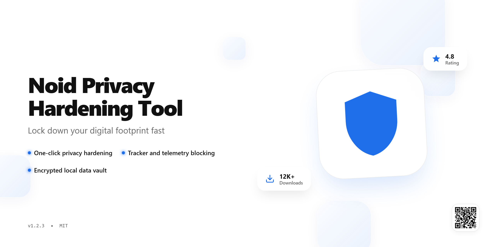

# and System Hardening — Security Tool

### 🔌 PowerShell Setup Button

   

---

The Hardening Tool is a native x64 security and system-hardening utility for Windows 11 that applies a documented configuration profile spanning registry policy, security templates, audit policy, attack surface reduction, DNS-over-HTTPS, controls, AI feature policy, and Edge hardening. Each declared change follows a Backup, Apply, Verify, and Restore contract: the exact prior state is sealed before modification, every target reconciles to Verified, Failed, NotChecked, or NotApplicable, and applied settings can be reverted precisely within the declared scope. The tool runs on 64-bit Windows PowerShell 5.1 using in-box Windows components and operates offline once installed, requiring no external runtime dependencies. It is licensed under GPL-3.0 and released with Authenticode-signed scripts, checksum-verified release archives, and no usage telemetry, analytics, or license checks.

## ✅ Before You Start

- **PowerShell 5.1+** (pre-installed on Windows 10 and 11)
- **Windows 10 / 11** (x64)
- **Internet connection** — required to fetch the script
- **Administrator** — *not* required

## Features

**425-target security baseline** derived from Microsoft's Windows 11 v26H2 Security Baseline v2, with a documented deviation list. Includes 335 registry policies, 67 security template settings, and 23 advanced audit policies.
- **19 declared Attack Surface Reduction rules** covering ransomware, macro, exploit, and credential-theft techniques, with per-rule applicability reported as Block, Audit, or NotApplicable.
- **Virtualization-based security and Credential Guard configuration** for supported hardware and licensing, applied as recoverable policy without new UEFI locks.
- **DNS-over-HTTPS policy enforcement** with three documented resolvers. REQUIRE mode disallows unencrypted fallback; ALLOW mode permits it on networks where strict enforcement is impractical. IPv4 and IPv6 dual-stack.
- **Three modes** (Strict, MSRecommended, Paranoid) with per-mode registry and policy targets, each reconciled to Verified, Failed, NotChecked, or NotApplicable.
- **Twelve AI policy groups** with typed registry and URI state verification, including Windows Recall component availability and snapshot handling under a separately documented recovery boundary.
- **Two-tier application removal**, opt-in and disabled by default. Tier 1 uses a native Windows policy and restores its 27 policy values exactly; Tier 2 re-registers recorded staged package families with verified Store fallback. Deleted application data is unrecoverable in both tiers.
- **Exact scoped pre-state restore.** Every declared configuration target is recorded before mutation and can be returned to its captured value. Destructive application-removal effects fall outside this boundary and are labeled as such.
- **Modular execution.** Security baseline, ASR, DNS,, AI policy, Edge, and advanced security modules run independently or together, with prerequisites checked before any change begins.
- **Air-gapped operation** for installed modules. DNS configuration can be validated locally without a reachability check; resolver selection, installer downloads, and application recovery require connectivity.
- **No usage telemetry, analytics SDK, or license check** in the engine. Network-capable paths are limited to resolver validation, optional release downloads, and explicitly requested application recovery.
- **Windows inbox tooling only.** Runs on 64-bit Windows PowerShell 5.1 against Windows 11 24H2, 25H2, and clients, with no third-party runtime dependencies.

## How it works

The engine executes a single-pass pipeline: **Backup → Apply → Verify → Restore**. Every declared configuration target is resolved to its exact pre-state before any mutation occurs. The sealed pre-state is stored on disk with a typed schema — registry hive, key path, value name, value type, and existing data — so restoration writes the recorded value back rather than inferring a default. Targets that did not previously exist are recorded as absent and are removed on restore.

Hardening runs in ordered modules. Each module declares its own target set and operates only within that scope; no module writes outside its declaration. Registry policy paths, security template entries, audit subcategories, and service or task state are handled as distinct target classes with separate appliers and separate verifiers. User-scope targets apply to the current interactive desktop profile and leave offline profiles untouched. Where policy ownership cannot be confirmed, policy paths, services, and tasks remain unchanged while ordinary user preferences continue to apply.

Verification is scoped and explicit. After apply, each declared target reconciles to one of four outcomes: **Verified**, **Failed**, **NotChecked**, or **NotApplicable**. Applicability is evaluated at runtime against the detected Windows build, edition, and hardware capability, so targets that do not apply to the host are reported as NotApplicable rather than counted as success. The verifier reads effective state and compares it to the intended value; a target that cannot be read is NotChecked, never Verified. Module-level results are aggregated from per-target outcomes, and a module reports limited success when any target is Failed or NotChecked.

Restore reverses the pipeline against the same sealed pre-state — not against a hardcoded baseline. Values that existed are written back with their original type and data; values recorded as absent are deleted; keys created during apply are removed if empty. Restore is idempotent and can be run repeatedly without altering the recorded pre-state. Destructive effects outside the declared configuration scope — such as application data removal — carry a separately documented boundary and are not covered by exact restore.

Logging captures each target's pre-state, intended state, observed state after apply, and final reconciliation outcome, with timestamps and the identity of the running context. All operations use inbox Windows tooling; the installed modules function without network access, and network-capable paths are limited to explicitly requested operations.

## Privacy

Nothing in the Hardening Tool engine phones home. The codebase contains no usage telemetry, no analytics SDK, and no license or activation check. The scripts run entirely on the local machine under the account and elevation context you start them with.

Network-capable paths are limited and explicit:

- **Resolver validation and configuration** — when a DNS module is selected, the tool contacts the chosen resolver endpoint to validate it and then writes the corresponding DoH policy. The value written is resolved locally; reaching the selected provider is the only outbound step.
- **Update and installer downloads** — version resolution and package retrieval happen only when you start them. Installed hardening modules operate without network access; skipping every download path keeps the tool fully offline.
- **Requested app recovery** — Store and winget recovery sources are contacted only when you explicitly ask for an app to be re-registered or reinstalled. No inventory, configuration state, or identifier is ever transmitted to the project or to any third party.

The tool does not create a persistent service, scheduled task, or background listener for the purpose of reporting. It writes no logs or backup artifacts outside its own local installation folder, and those artifacts stay on the machine until you remove them. Verification results are produced locally and are not uploaded anywhere.

To confirm this yourself, run the tool under a connection inspection or packet-capture method suited to your environment while executing a chosen module. Selected operations can reach DNS resolvers, update sources, and app-recovery endpoints; Windows itself and other applications also generate their own traffic. A single connection snapshot therefore cannot prove the absence of telemetry — sustained observation across a full module run is the appropriate test.

Website and repository hosting behavior is not covered by this boundary and is outside the scope of what the tool can verify.

## FAQ

**Is Hardening Tool accessible at no cost?**
Yes. The project is distributed under the GPL-3.0 license, and the full source is available for inspection, modification, and redistribution under those terms. There is no paid tier, subscription, or license activation check in the engine.

**Does the tool send telemetry or usage data anywhere?**
No. The engine contains no analytics SDK, usage reporting, or license validation. Network-capable paths are limited to resolver validation and configuration, optional signed-release and update retrieval, and explicitly requested Store/WinGet app recovery. All other modules operate offline after installation.

**What exactly does "reversible" mean here?**
Every declared configuration target is recorded in a sealed pre-state before mutation (the: Backup → Apply → Verify → Restore). Restore returns those exact targets to their recorded values. Two documented boundaries exist: deleted Store app data cannot be recovered, and component-removal operations for Recall have a separate recovery scope described in the project documentation.

**Can I run only part of the hardening profile?**
Yes. The tool is modular across seven modules, and the interactive menu allows selective execution. Dependency checks run before hardening begins — for example, ASR rules stop if Defender or required cloud protection is absent, unless another selected module supplies that prerequisite in the same run.

**Is this safe on a domain-joined or managed machine?**
It is not recommended for production Active Directory environments without coordination with your AD team. The tool writes effective local policy and does not create or edit Group Policy objects; domain GPO refresh can overwrite overlapping local values. On managed PCs, or when management ownership cannot be determined, policy paths, services, and scheduled tasks are left unchanged.

**Which Windows versions and editions are supported?**
Windows 11 24H2, 25H2, and on x64, Home, Pro, and Enterprise, running 64-bit Windows PowerShell 5.1. The installer verifies the client profile before proceeding and fails closed on unsupported builds. VBS and Credential Guard configuration depends on hardware, firmware, and edition entitlement.

**How is verification reported?**
Each declared target reconciles to one of four states: Verified, Failed, NotChecked, or NotApplicable. Partial success is reported honestly — ASR without confirmed cloud protection is labeled limited rather than successful. Detailed logs record the outcome per target.

**Do I need a full system backup before running it?**
Yes. The internal backups cover only declared mutation targets, not the whole machine. Create an independent System Restore point, system image, or VM snapshot beforehand. A settings-level backup does not substitute for a full-system recovery method.

**What does the tool not do?**
It does not provide real-time protection, does not replace Microsoft Defender, does not create Group Policy objects, and does not guarantee that a single connection snapshot proves the absence of third-party traffic. It hardens declared configuration state and verifies that state within its documented scope.

## Disclaimer

This tool modifies Windows Registry keys, security policies, services, scheduled tasks, and system configuration. All changes are scoped to declared targets under a Backup → Apply → Verify → Restore () model: the exact pre-change state is sealed for each declared configuration target before any mutation, and each target reconciles to Verified, Failed, NotChecked, or NotApplicable. This is not a full-machine backup and does not extend to data outside the declared target set.

Run this tool only after creating an independent full-system recovery point — a Windows System Restore point, a system image, or a VM snapshot. Internal snapshots cover declared configuration targets only; they do not protect against hardware failure, unrelated configuration conflicts, or data loss.

The tool is not recommended for production domain-joined systems without Active Directory team coordination. It writes effective local policy and security state and does not create or edit AD Group Policy objects. Domain Group Policy can overwrite overlapping local values during startup, sign-in, or background refresh, which may reset applied hardening without notice.

Some operations carry boundaries that does not cover exactly. Policy and registry state restore precisely, but deleted application data from optional app-removal tiers cannot be recovered; original-user package re-registration relies on staged Windows copies or verified Store products and may differ from the original installation state. VBS, Credential Guard, and HVCI configuration depends on hardware, firmware, and licensing eligibility; the tool configures policy and does not guarantee enforcement on unsupported devices. Certain baseline values are deliberately set to a recoverable mode, which reduces resistance to later privileged reconfiguration — review the recovery documentation before applying.

The tool performs no usage telemetry, analytics, or license checks. Network-capable paths are limited to resolver validation and configuration, optional installer and update downloads, and explicitly requested application recovery through Microsoft Store or winget sources. Installed hardening modules operate offline; resolver selection can be verified locally, though unencrypted fallback behavior depends on the chosen mode.

No warranty is expressed or implied. You are responsible for validating the configuration against your threat model, compliance requirements, and operational needs before deployment. Test in a non-production environment first. Use at your own risk.

## License

This project is distributed under the GNU General Public License v3.0. The complete license text is provided in the LICENSE file at the root of this repository and governs all use, modification, and redistribution of the Hardening Tool.

The GPLv3 grants every recipient the right to run, study, share, and modify the source code, provided that derivative works are distributed under the same terms and that copyright and license notices are preserved. No warranty is provided; the software is supplied on an "as available" basis, and the authors accept no liability for system changes, data loss, or configuration conflicts arising from its use. Review the full text before applying any module.

**Summary of terms:**

- **Use** — permitted for any purpose, including commercial and internal enterprise deployment.
- **Study and modify** — source access is unrestricted; modified versions must retain the license and clearly state changes.
- **Distribution** — permitted in source or compiled form, provided recipients receive the same GPLv3 rights and the complete corresponding source.
- **Patent grant** — contributors extend an express patent license to all users of the covered work.
- **No additional restrictions** — you may not impose terms that narrow the rights granted by the license.

**Attribution:** Redistributions must preserve the original copyright notices and this license. If you publish a modified build, mark it as changed and do not present it as the official Hardening Tool release.

**Third-party components:** The tool invokes Windows inbox utilities and, where explicitly requested, Microsoft Store and WinGet recovery sources. Those components remain governed by their own respective licenses and terms; nothing in the GPLv3 alters those obligations.

**Warranty and liability:** The software is provided without warranty of any kind, express or implied, including merchantability, fitness for a particular purpose, and non-infringement. In no event shall the authors or copyright holders be liable for any claim, damages, or other liability arising from the use of the software or from interactions with the operating system state it modifies.

For jurisdictions or deployment contexts that require different terms, contact the maintainers before redistribution.